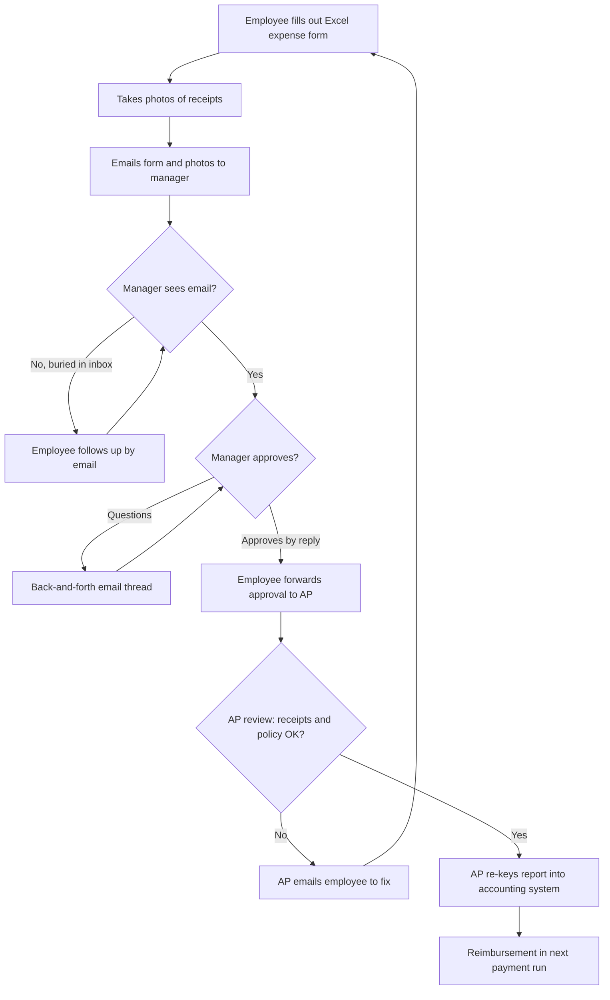
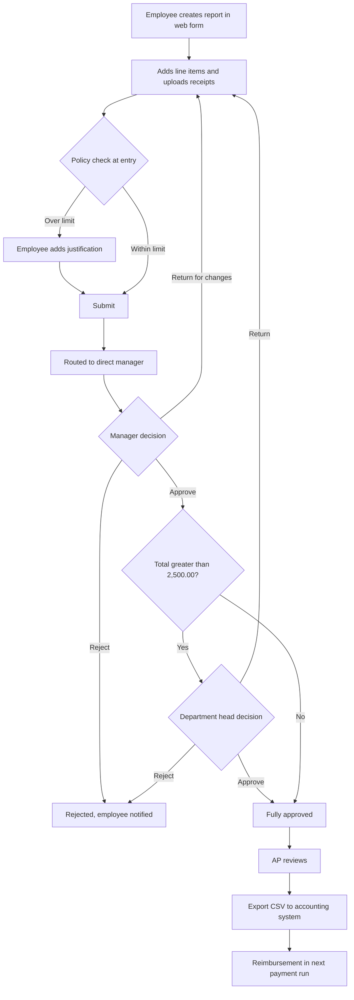
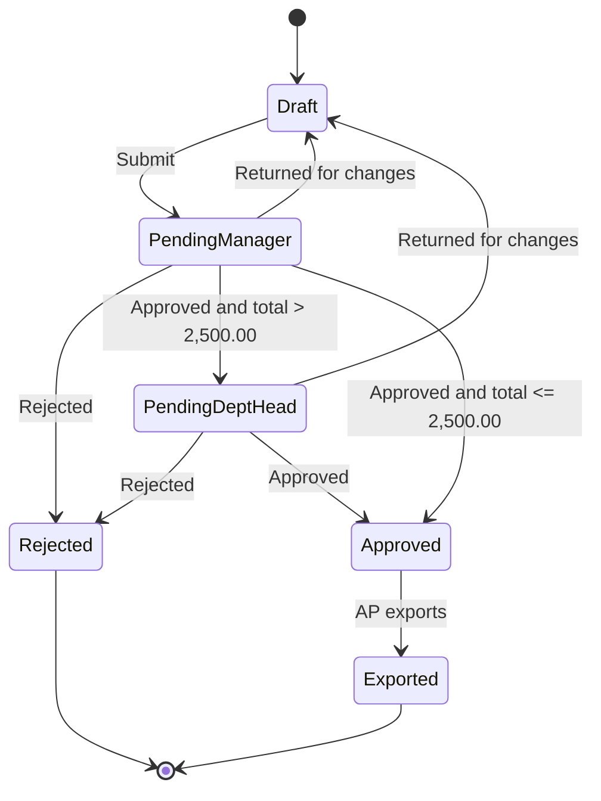

# Process Flows

## Current state (as-is)

**Problems visible in the flow:** two loops that send work back to the start, policy checked only at the end by AP, manual re-keying, and no status anywhere except email.

## Future state (to-be)

**What changed:** receipts and policy are checked before submission instead of at the end, routing is automatic, the only loop back is an intentional "return for changes," and the export replaces re-keying.

## Report status lifecycle

Every transition writes an entry to the audit log (BR-09) and triggers a notification (BR-07).
